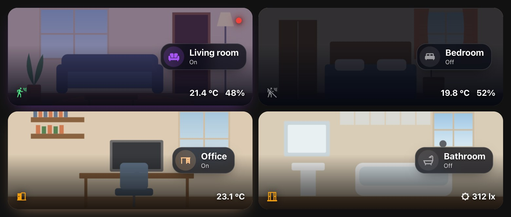
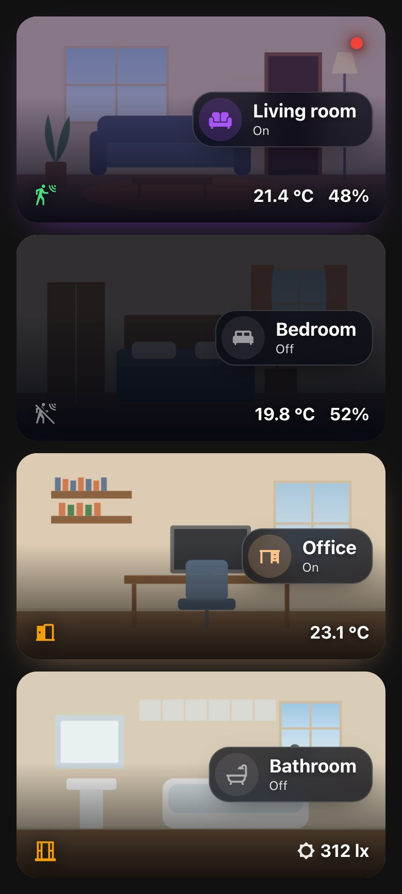
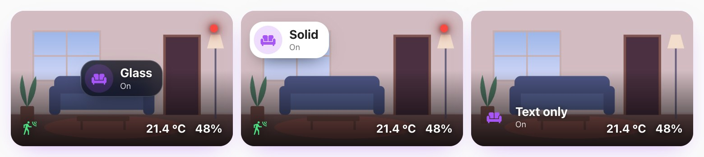
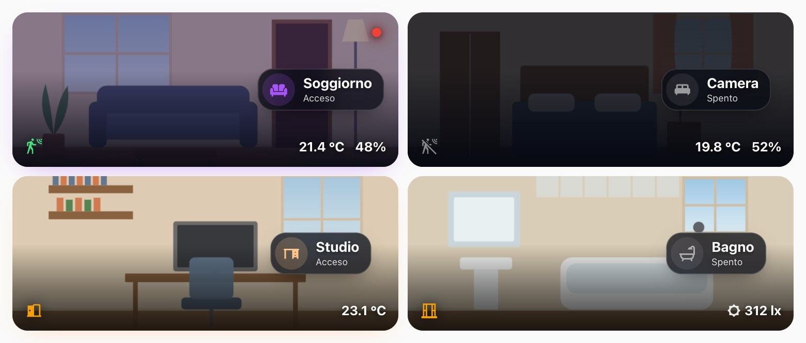

# Room Hero Card

[![hacs][hacs-badge]][hacs-url]
[![release][release-badge]][release-url]
[![validate][validate-badge]][validate-url]
[![license][license-badge]](LICENSE)

A Home Assistant card with a **photo of the room that lives with it**: it darkens at night, takes the
colour and brightness of the room's light, and carries a glass pill to switch it, the room's values
and small status indicators — a moving person, a camera that is recording, a window left open.



> The rooms in these screenshots are drawn, not photos of a real home. Run `npm run screenshots` to
> regenerate them.

## Why

A photo of the room is the quickest way to find it on a dashboard, and the photo can tell you more:
whether the light is on, what colour it is, whether it is night. Getting there with stock cards means a
`picture-elements` card, a handful of `conditional` elements, a mushroom card on top and around a hundred
lines of `card-mod` CSS with Jinja inside — **per room**, copied and slowly drifting apart.

This card does all of it from a dozen lines of configuration, or from the visual editor.

## Features

- **The photo follows the light** — a tint in the light's own colour, stronger as it gets brighter;
  warm white for lights without colour. A thin border and a soft glow in the same colour while it is on.
- **…and the night** — a dark veil after sunset that the light lifts as it gets brighter. By day, just a
  fade at the bottom so the text stays readable. Driven by `sun.sun` or any entity you choose.
- **A glass pill** — room name and on/off; tap the icon to switch the light, tap the pill for its details.
  Nine preset positions or any `x% y%`; glass, solid or text-only. It never leaves the photo, even on a phone.
- **Values** — temperature, humidity, illuminance, any entity or attribute, formatted the way Home Assistant
  formats them, or with your decimals and unit.
- **Indicators** — small icons in the corners, with presets for **motion**, **presence**, **recording
  camera** (a blinking red dot), **door**, **window** and **alarm**. Every detail can be overridden.
- **Standard actions** everywhere — tap, hold and double tap, with every action Home Assistant supports.
- **Image from anywhere** — `/local/…`, a URL, a `media-source://` item (served through a signed URL), or the
  picture of a camera, image or person entity.
- **Visual editor** with sections, rows for values and indicators, **English and Italian**, light and dark
  themes, sections-grid sizing. Redraws only when an entity it uses changes.
- No dependencies, no build step.

| Phone | Pill styles | Italian |
|---|---|---|
|  |  |  |

## Installation

### HACS (recommended)

[](https://my.home-assistant.io/redirect/hacs_repository/?owner=sleepyraptor&repository=homeassistant-room-hero-card&category=plugin)

That button opens the repository straight in your own Home Assistant. By hand:

1. In HACS, open the three-dot menu and choose **Custom repositories**.
2. Add `https://github.com/sleepyraptor/homeassistant-room-hero-card` with category **Dashboard**.
3. Install **Room Hero Card**.
4. Reload your browser with a hard refresh (`Ctrl/Cmd + Shift + R`). In the companion app:
   **Settings → Companion app → Debugging → Reset frontend cache**.

### Manual

1. Download `room-hero-card.js` from the [latest release][release-url].
2. Copy it into `config/www/`.
3. Add the resource under **Settings → Dashboards → ⋮ → Resources**:
   `/local/room-hero-card.js`, type **JavaScript module**.
4. Hard refresh the browser.

## Quick start

Put a photo of the room in `config/www/rooms/` (it becomes `/local/rooms/…`), add the card from the picker
(**Room Hero Card**) and fill in name, image and light. Or in YAML:

```yaml
type: custom:room-hero-card
name: Living room
icon: mdi:sofa
image: /local/rooms/living_room.jpg
light: light.living_room
sensors:
  - sensor.living_room_temperature
  - sensor.living_room_humidity
indicators:
  - preset: motion
    entity: binary_sensor.living_room_motion
  - preset: recording
    entity: switch.living_room_camera
```

## Configuration

Every option is in the visual editor. Only `type` is required: a card with nothing else shows a neutral
background and is ready to fill in.

### Room

| Option | Default | Description |
|---|---|---|
| `name` | the light's name | Shown in the pill. |
| `icon` | `mdi:sofa` | Shown in the pill. |
| `image` | — | `/local/…`, `https://…` or `media-source://…`. Without an image the card has a neutral gradient. |
| `image_entity` | — | A `camera`, `image` or `person` entity: its picture becomes the background (and wins over `image`). |
| `image_position` | `center` | CSS `background-position`: `top`, `bottom`, `50% 30%`… |
| `height` | `200` | Height in pixels. The card asks the sections grid for the matching number of rows. |
| `radius` | `20` | Corner radius in pixels. |

### Light and pill

| Option | Default | Description |
|---|---|---|
| `light` | — | A `light` (or `switch`, `fan`, `input_boolean`, `media_player`). Its colour and brightness tint the photo; the pill switches it. |
| `glow` | `true` | Tint the photo with the light's colour. |
| `glow_strength` | `0.14` | How strong the tint gets at full brightness (`0`–`0.6`). |
| `border` | `true` | Border and glow in the light's colour while it is on. |
| `show_state` | `true` | On/off under the name. |
| `state_on` / `state_off` | *On* / *Off* in your language | Custom texts. |
| `pill_position` | `80% 50%` | `top-left`, `top-center`, `top-right`, `center-left`, `center`, `center-right`, `bottom-left`, `bottom-center`, `bottom-right`, or `"x% y%"` for the pill's centre. |
| `pill_style` | `glass` | `glass`, `solid` (theme card colour) or `none` (text only). |
| `values_position` | `bottom-right` | The corner for the values: `top-left`, `top-right`, `bottom-left`, `bottom-right`. |

### Night

| Option | Default | Description |
|---|---|---|
| `night` | `auto` | `auto` follows `night_entity`; `always` or `never` force it. |
| `night_entity` | `sun.sun` | Any entity. |
| `night_state` | `below_horizon` | The state that means night (e.g. `on` for an `input_boolean`). |
| `dim` | `0.82` | Darkness of the night veil with the light off (`0`–`1`). At full brightness it lifts to about a third. |

### Actions

| Option | Default | Description |
|---|---|---|
| `tap_action` | `more-info` of the light | Tap on the pill. |
| `hold_action` | `more-info` of the light | Hold on the pill. |
| `double_tap_action` | — | Double tap on the pill. |
| `icon_tap_action` | `toggle` the light | Tap on the pill's icon. |
| `icon_hold_action` | `more-info` of the light | Hold on the pill's icon. |

Every action Home Assistant supports works: `more-info`, `toggle`, `navigate`, `url`, `perform-action`,
`assist`, `none`.

### Values (`sensors`)

A list; each item is an entity id, or:

| Key | Description |
|---|---|
| `entity` | **Required.** |
| `attribute` | Show an attribute instead of the state. |
| `icon` | Small icon before the value. |
| `name` | Small label before the value. |
| `unit` | Replace the unit. |
| `decimals` | Round to this many decimals (with the entity's unit, or `unit`). |
| `tap_action` / `hold_action` | Default: `more-info`. |

Without `decimals` or `unit`, values are formatted by Home Assistant itself, in your language.

### Indicators (`indicators`)

A list; each item:

| Key | Description |
|---|---|
| `preset` | `motion`, `presence`, `recording`, `door`, `window`, `alarm` — fills in everything below. |
| `entity` | **Required.** |
| `state` | The states that count as "on" (a list, or comma-separated). Default: `on`, `open`, `home`, `detected`, `playing`, `unlocked`, `triggered`… |
| `icon` / `icon_off` | Icons for on and off. |
| `color` / `color_off` | Any CSS colour. |
| `position` | `top-left`, `top-right` (default), `bottom-left`, `bottom-right`. Several indicators in a corner line up. |
| `size` | Icon size in pixels (default `22`). |
| `blink` | Blink while on. |
| `hide_off` | Show it only while on. |
| `tap_action` / `hold_action` | Default: `more-info`. |

| Preset | On | Off | Where |
|---|---|---|---|
| `motion` | green moving person | faded still person | bottom left |
| `presence` | green person | faded outline | bottom left |
| `recording` | blinking red dot with a halo | hidden | top right |
| `door` / `window` | amber open | faded closed | bottom left |
| `alarm` | blinking red shield on `triggered`, `pending`, `arming` | faded shield | top left |

### Full example

```yaml
type: custom:room-hero-card
name: Living room
icon: mdi:sofa
image: /local/rooms/living_room.jpg
image_position: 50% 60%
height: 220
light: light.living_room_led
glow_strength: 0.2
state_on: Lit
pill_position: 75% 45%
night_entity: input_boolean.night_mode
night_state: "on"
icon_hold_action:
  action: navigate
  navigation_path: /dashboard-home/lights
sensors:
  - entity: sensor.living_room_temperature
    decimals: 1
  - entity: sensor.living_room_humidity
    icon: mdi:water-percent
indicators:
  - preset: motion
    entity: binary_sensor.living_room_motion
  - preset: recording
    entity: switch.living_room_camera
    tap_action:
      action: navigate
      navigation_path: /dashboard-security/cameras
  - preset: window
    entity: binary_sensor.living_room_window
    position: bottom-left
    hide_off: true
```

## Coming from picture-elements + card-mod

If your room cards are a `picture-elements` with `state-label`s, `conditional` icons and a
mushroom card on top, styled with card-mod:

| You had | Use |
|---|---|
| `image` + card-mod `background-image`, `height`, `border-radius` | `image`, `height`, `radius` |
| Jinja reading `rgb_color` / `brightness` in card-mod | `light` (and `glow`, `glow_strength`, `border`) |
| Jinja on `sun.sun` for a night overlay | nothing — `night: auto` is the default |
| `state-label`s at the bottom right | `sensors` |
| `conditional` + `icon` for motion | `indicators: [{ preset: motion, entity: … }]` |
| blinking dot with a `@keyframes` in card-mod | `indicators: [{ preset: recording, entity: … }]` |
| mushroom template card with glass card-mod as the room name | the pill: `name`, `icon`, `pill_position`, `pill_style` |

## Development

```bash
npm install
npm test               # node --test with happy-dom
npm run demo           # the card on drawn rooms: http://127.0.0.1:8766/demo/
npm run screenshots    # regenerates docs/*.jpg with a local Chrome (set CHROME=… if needed)
```

The card is a single file, `dist/room-hero-card.js`, with no build step.

## License

[MIT](LICENSE)

[hacs-badge]: https://img.shields.io/badge/HACS-Custom-41BDF5.svg
[hacs-url]: https://hacs.xyz
[release-badge]: https://img.shields.io/github/v/release/sleepyraptor/homeassistant-room-hero-card
[release-url]: https://github.com/sleepyraptor/homeassistant-room-hero-card/releases/latest
[validate-badge]: https://github.com/sleepyraptor/homeassistant-room-hero-card/actions/workflows/validate.yml/badge.svg
[validate-url]: https://github.com/sleepyraptor/homeassistant-room-hero-card/actions/workflows/validate.yml
[license-badge]: https://img.shields.io/github/license/sleepyraptor/homeassistant-room-hero-card
